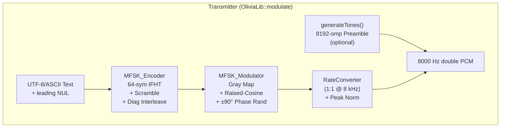
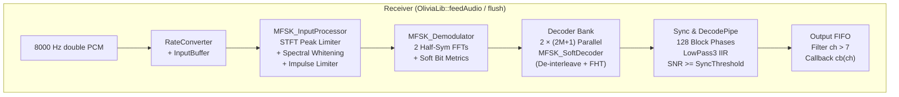

# DSP Architecture & Protocol Internals

This document describes the Olivia MFSK waveform, signal-processing pipeline, mathematical parameters, and internal Jalocha DSP template library bundled in [`include/jalocha/`](../include/jalocha/).

---

## Architectural Overview

`olivia-modem` has two cleanly separated layers:

1. **Public C++20 Wrapper (`include/oliviamodem.h`, `src/oliviamodem.cpp`):**
   Provides `OliviaConfig` and `OliviaLib` via a PIMPL (`OliviaLib::Impl`), handles preamble tone generation, computes `FirstCarrierMultiplier` from `carrierHz` and `bandwidthHz`, clamps squelch, and filters decoded idle/control characters (`ch > 7`).
2. **Jalocha Header-Only DSP Core (`include/jalocha/*.h`):**
   Pawel Jalocha's templated C++ implementation of the Olivia MFSK physical and FEC layers, extracted directly from fldigi with zero external dependencies beyond `<cmath>` / `libm`.

### Signal Processing Flow





---

## Waveform Geometry & Mode Math

Olivia is an orthogonal **M-ary Frequency Shift Keying (MFSK)** mode with 50% overlapping raised-cosine symbols. All timing and frequency relationships are derived from two primary parameters: **`Tones`** ($M = 2^b$) and **`Bandwidth`** ($B \in \{125, 250, 500, 1000, 2000\}\text{ Hz}$) at sample rate $f_s = 8000\text{ Hz}$.

### Core Formulas (`pj_mfsk.h`)

| Quantity | Formula | Description |
| --- | --- | --- |
| Bits per symbol | $b = \log_2(M)$ | Also equals **characters per FEC block**. |
| Symbols per FEC block | $L_{\text{blk}} = 2^{\text{BitsPerCharacter} - 1} = 64$ | Standard Olivia uses 7-bit ASCII (`BitsPerCharacter = 7`). |
| FFT / Symbol length | $N = 2^{b + 7 - \log_2(B / 125)}$ | Power-of-two FFT window in samples. |
| Symbol separation | $S = N / 2$ | Hop size in samples (50% time overlap between adjacent symbols). |
| FFT bin width | $\Delta f_{\text{bin}} = f_s / N$ | Frequency resolution of demodulator FFT. |
| Carrier separation | $\text{CarrierSepar} = 2$ bins | Adjacent tones are spaced by 2 FFT bins. |
| Tone spacing | $\Delta f_{\text{tone}} = 2 \cdot \Delta f_{\text{bin}} = B / M$ | Exact frequency spacing between adjacent tones. |
| Symbol rate (baud) | $R_s = f_s / S = B / M$ | Equals tone spacing (orthogonality condition). |
| FEC block period | $T_{\text{blk}} = (64 \cdot S) / f_s = 64 / R_s$ | Duration of one 64-symbol FEC block in seconds. |
| Character rate | $R_c = b / T_{\text{blk}}$ | Throughput in characters per second (7-bit ASCII). |
| InputProcessor window | $W_{\text{in}} = 16 \cdot N$ | STFT pre-processor block size in samples. |
| Tuning search margin | $\Delta f_{\text{tune}} = \pm \text{SyncMargin} \cdot \Delta f_{\text{bin}}$ | Half-width of receiver frequency search (`±SyncMargin/2` tone spacings). |

### Carrier Centering (`oliviamodem.cpp`)

To center all $M$ tones symmetrically around `carrierHz` ($f_c$), `setupTx()` and `setupRx()` compute:

$$f_{\text{offset}} = \frac{B \cdot \left(1 - \frac{0.5}{M}\right)}{2}, \qquad \text{FirstCarrierMultiplier} = \frac{f_c - f_{\text{offset}}}{500.0}$$

Inside `MFSK_Transmitter::Preset()` and `MFSK_Receiver::Preset()`:

$$\text{FirstCarrier} = \left\lfloor \frac{N}{16} \cdot \text{FirstCarrierMultiplier} \right\rfloor + 1$$

Because $f_s = 8000 = 16 \times 500$, $(N / 16) / 500 = 1 / \Delta f_{\text{bin}}$. Tone $k \in \{0, \dots, M-1\}$ sits at FFT bin $\text{FirstCarrier} + 2k$, placing the lowest and highest tone centers symmetrically around $f_c$ and spanning an occupied bandwidth of $B\text{ Hz}$.

### Verified Parameter Table (`f_s = 8000 Hz`, `carrierHz = 1500 Hz`)

| Mode | $b$ | `SymbolLen` ($N$) | `SymbolSepar` ($S$) | $\Delta f_{\text{bin}}$ (Hz) | Tone Spacing / Baud | Block Period (s) | Chars/s | 5-ch WPM | `WindowLen` (s) | Margin (`M=8`) | Tone Centers @ 1500 Hz |
| --- | --- | --- | --- | --- | --- | --- | --- | --- | --- | --- | --- |
| `4/125` | 2 | 512 | 256 | 15.625 | 31.250 | 2.05 | 0.98 | 11.7 | 1.02 | ±125.0 Hz | 1453.1 – 1546.9 Hz |
| `4/250` | 2 | 256 | 128 | 31.250 | 62.500 | 1.02 | 1.95 | 23.4 | 0.51 | ±250.0 Hz | 1406.2 – 1593.8 Hz |
| `4/500` | 2 | 128 | 64 | 62.500 | 125.000 | 0.51 | 3.91 | 46.9 | 0.26 | ±500.0 Hz | 1312.5 – 1687.5 Hz |
| `8/250` | 3 | 512 | 256 | 15.625 | 31.250 | 2.05 | 1.46 | 17.6 | 1.02 | ±125.0 Hz | 1390.6 – 1609.4 Hz |
| `8/500` | 3 | 256 | 128 | 31.250 | 62.500 | 1.02 | 2.93 | 35.2 | 0.51 | ±250.0 Hz | 1281.2 – 1718.8 Hz |
| `8/1000` | 3 | 128 | 64 | 62.500 | 125.000 | 0.51 | 5.86 | 70.3 | 0.26 | ±500.0 Hz | 1062.5 – 1937.5 Hz |
| `16/500` | 4 | 512 | 256 | 15.625 | 31.250 | 2.05 | 1.95 | 23.4 | 1.02 | ±125.0 Hz | 1265.6 – 1734.4 Hz |
| `16/1000` | 4 | 256 | 128 | 31.250 | 62.500 | 1.02 | 3.91 | 46.9 | 0.51 | ±250.0 Hz | 1031.2 – 1968.8 Hz |
| `16/2000` | 4 | 128 | 64 | 62.500 | 125.000 | 0.51 | 7.81 | 93.8 | 0.26 | ±500.0 Hz | 562.5 – 2437.5 Hz |
| `32/1000` | 5 | 512 | 256 | 15.625 | 31.250 | 2.05 | 2.44 | 29.3 | 1.02 | ±125.0 Hz | 1015.6 – 1984.4 Hz |
| `32/2000` | 5 | 256 | 128 | 31.250 | 62.500 | 1.02 | 4.88 | 58.6 | 0.51 | ±250.0 Hz | 531.2 – 2468.8 Hz |
| `64/2000` | 6 | 512 | 256 | 15.625 | 31.250 | 2.05 | 2.93 | 35.2 | 1.02 | ±125.0 Hz | 515.6 – 2484.4 Hz |

---

## Layer 1: Walsh–Hadamard FEC & Interleaving

Implemented by `MFSK_Encoder`, `MFSK_SoftDecoder` (`pj_mfsk.h`), and `FHT`/`IFHT` (`pj_fht.h`).

### Encoding (`MFSK_Encoder::EncodeBlock`)

Each FEC block encodes `BitsPerSymbol` ($b$) 7-bit ASCII characters into a sequence of `64` MFSK symbols (each symbol carrying $b$ bits):

1. **First-Order Reed–Muller / Bi-Orthogonal Walsh–Hadamard Mapping (`EncodeCharacter`):**
   - Input character `c` is masked to 7 bits (`0..127`).
   - A 64-element buffer `FHT_Buffer[0..63]` is zeroed; a single impulse is placed:
     - If `c < 64`: `FHT_Buffer[c] = +1`
     - If `c >= 64`: `FHT_Buffer[c - 64] = -1`
   - An in-place **Inverse Fast Hadamard Transform (`IFHT`)** transforms that impulse into a 64-chip bipolar (`±1`) Walsh–Hadamard codeword. Any two distinct codewords have either zero correlation (orthogonal) or `-64` correlation (antipodal), yielding huge coding gain under additive white Gaussian noise (AWGN) and burst errors.

2. **Pseudorandom Scrambling (`ScrambleFHT`):**
   - Each character's 64-chip codeword is XOR-inverted (sign-flipped) against the fixed 64-bit Olivia scrambling vector:
     ```cpp
     ScramblingCodeOlivia = 0xE257E6D0291574ECULL
     ```
   - Character index `FreqBit` ($0 \le j < b$) starts at cyclic bit offset `(j * 13) mod 64`.
   - Scrambling breaks up periodicity so idle (`NUL`) blocks and repeated characters spread energy uniformly across all tones and provide sharp autocorrelation peaks for blind time/frequency synchronization.

3. **Diagonal Time–Frequency Interleaving:**
   - For each character $j \in \{0, \dots, b-1\}$ and symbol time $t \in \{0, \dots, 63\}$, the scrambled chip sign (`FHT_Buffer[t] < 0` → bit `1`, else `0`) is written into bit position:
     $$\text{Bit} = (j + t) \bmod b$$
     of `OutputBlock[t]`.
   - Because each character's bits cycle across all $b$ bit planes of the MFSK symbol over 64 symbol periods, selective fading or a single-tone interferer affects only a fraction of any character's 64 chips.

### Soft-Decision Decoding (`MFSK_SoftDecoder::DecodeCharacter`)

1. `Input(Symbol)` appends $b$ soft bit values (positive favoring `0`, negative favoring `1`) into a circular `InputBuffer` of length $64 \times b$.
2. For each character $j$, `DecodeCharacter(j)` gathers 64 soft bits along the diagonal `(j + t) mod b`, undoes the scrambling signs using `ScramblingCodeOlivia` shifted by `(j * 13) mod 64`, and runs the forward **Fast Hadamard Transform (`FHT`)**.
3. The bin `PeakPos` with maximum `|FHT_Buffer[t]|` selects the decoded character:
   - `Peak >= 0` → `Char = PeakPos` (`0..63`)
   - `Peak < 0` → `Char = PeakPos + 64` (`64..127`)
4. **Signal and Noise Estimation:**
   - `Signal` accumulates `|Peak|` averaged over the $b$ characters in the block.
   - `NoiseEnergy` accumulates `(SqrSum - Peak^2) / 63` (mean squared energy of the 63 non-peak orthogonal Hadamard bins) averaged over the $b$ characters.

---

## Layer 2: MFSK Modulation & Preamble Tones

Implemented by `MFSK_Modulator` (`pj_mfsk.h`) and `generateTones()` (`src/oliviamodem.cpp`).

### Gray-Coded MFSK with Raised-Cosine Windowing

For each 64-block symbol `s`:

1. **Gray Coding (`pj_gray.h`):** `g = s ^ (s >> 1)` ensures adjacent frequency tones differ by only 1 bit, minimizing bit errors caused by slight frequency drift or adjacent-tone leakage.
2. **Tone Selection:** FFT bin `SymbolFreq = FirstCarrier + 2 * g` (or reversed downward if `Reverse == 1`).
3. **50%-Overlapping Raised-Cosine Shaping:**
   - Each symbol has duration `SymbolLen` samples with envelope `Shape(t) = 1.0 - cos(2πt / SymbolLen)` (a Hann / raised-cosine window) and is overlap-added into the circular `OutTap` buffer every `SymbolSepar = SymbolLen / 2` samples.
   - This window tightly confines spectral sidelobes while maintaining smooth constant-envelope-like transitions.
4. **Inter-Symbol Phase Randomization:**
   - Between consecutive symbols, `SymbolPhase` is advanced continuously across the symbol boundary and then shifted randomly by `±SymbolLen / 4` (`±90°`) via `rand() & 1`. This prevents coherent spectral lines when repeating identical symbols and keeps the peak-to-average power ratio low.
5. **Output Rate Conversion & Normalization (`MFSK_Transmitter::Output`):**
   - Passes through `RateConverter` (Blackman–Harris windowed sinc interpolator; ratio `1.0` when `OutputSampleRate == SampleRate == 8000`).
   - Normalizes each `SymbolSepar`-sample batch by its peak magnitude to `[-1.0, +1.0]`.

### Synchronization Preamble Tones (`generateTones`)

When `OliviaConfig::sendTones` is `true`, `OliviaLib::modulate()` prepends a `8192`-sample (`1.024 s`) dual-tone marker matching fldigi's `olivia::send_tones()`:

- Frequencies: `freqA = carrierHz - bandwidthHz / 2`, `freqB = carrierHz + bandwidthHz / 2`.
- Structure: 4 consecutive segments of `2048` samples (`256 ms` each) in the sequence **`A, B, A, B`**.
- Edge shaping: Each 2048-sample burst has a `256`-sample (`32 ms`) raised-cosine fade-in and fade-out (`0.5 * (1 - cos(πi / 256))`) to prevent key clicks.

---

## Layer 3: Receiver Spectral Pre-Conditioning (`MFSK_InputProcessor`)

Before demodulation, `MFSK_Receiver` buffers incoming samples into blocks of `WindowLen = 16 * SymbolLen` samples (`4096` samples / `0.512 s` for `8/500`, `8192` samples / `1.024 s` for `16/500` and `32/1000`) and runs `MFSK_InputProcessor::Process()`:

1. **Dual-Real 50%-Overlapping STFT:**
   - Packs two consecutive half-overlapping `WindowLen` frames into the real and imaginary parts of one complex `r2FFT` buffer using a sine analysis/synthesis window `sqrt(1 - cos(2πt / WindowLen))`, then separates both real spectra via `FFT.SeparTwoReals()`.
2. **Narrowband Carrier / QRM Suppression (`LimitSpectraPeaks`, 3 passes):**
   - Computes local moving-average spectral power with a `BoxFilter` of width `WindowLen / 64` across the lower 75% of the spectrum (`0 .. 3000 Hz`).
   - Any bin whose energy exceeds `4.0 ×` the local mean is attenuated back to the threshold (`Spectra[idx] *= sqrt(Limit / Signal)`). Running 3 passes aggressively flattens strong continuous-wave (CW) carriers and heterodynes without harming the frequency-hopping Olivia tones.
3. **Spectral Whitening / Equalization (`AverageEnergy`, 2 passes):**
   - Smooths the remaining energy spectrum with box filters of width `WindowLen / 96` and `WindowLen / 64`, then scales each spectral bin by `1 / sqrt(Energy[freq])`.
   - Flattens receiver passband ripple and colored HF noise before demodulation.
4. **Inverse STFT & Impulse Noise Blanking (`LimitOutputPeaks`, 2 passes):**
   - Rejoins both spectra (`JoinTwoReals`), runs the inverse FFT, overlap-adds into the time domain, and hard-clips samples exceeding `±2.5 × RMS` (2 passes) to suppress static crashes (QRN) and lightning impulses.

---

## Layer 4: Demodulation & Multi-Hypothesis Synchronization

Implemented by `MFSK_Demodulator` and `MFSK_Receiver` (`pj_mfsk.h`).

### Half-Symbol FFT Demodulation (`MFSK_Demodulator`)

For every symbol period (`SymbolSepar` samples):

- Computes **two** overlapping `SymbolLen`-point windowed FFTs spaced by `SymbolSepar / 2` (half a symbol apart, `SlicesPerSymbol = 2`), using the same dual-real FFT trick (`Spectra[0]` and `Spectra[1]`).
- Extracts bin energies `Energy[slice]` over the search window `DecodeWidth = (2 * Carriers - 1) + 2 * SyncMargin`.
- **`SoftDecode(Symbol, Slice, FreqOffset)`** computes soft bit metrics for each of the $b$ bits by squaring tone energies (`E^2`), inverting Gray code (`BinaryCode`), accumulating `+E^2` for bit `0` and `-E^2` for bit `1`, and normalizing by total squared energy `TotalEnergy`.

### Blind Time–Frequency Synchronization (`MFSK_Receiver::ProcessSymbol`)

Olivia does not require an explicit frame header to synchronize—it searches **all** candidate time phases and frequency offsets simultaneously:

- **Frequency hypotheses:** `FreqOffsets = 2 * SyncMargin + 1` FFT bins (e.g., `17` offsets for `syncMargin = 8`).
- **Time-phase hypotheses:** `BlockPhases = SlicesPerSymbol * SymbolsPerBlock = 2 * 64 = 128` half-symbol phases per FEC block.
- **Parallel decoder bank:** `SlicesPerSymbol * FreqOffsets` (`2 * (2 * SyncMargin + 1)`) independent `MFSK_SoftDecoder` instances run on every half-symbol slice.
- **3rd-Order IIR Integration (`LowPass3_Filter`):**
  - Every `(BlockPhase, FreqOffset)` hypothesis maintains a smoothed signal amplitude (`SyncSignal`) and smoothed noise variance (`SyncNoiseEnergy`) updated with `Weight = 1.0 / SyncIntegLen` and `Feedback = 0.1` (`~1e-6` overshoot).
  - The phase/offset pair achieving the highest integrated Walsh–Hadamard peak becomes `(SyncBestBlockPhase, SyncBestFreqOffset)`.
- **Deferred Output Pipeline (`DecodePipe`):**
  - Decoded $b$-character blocks (packed into a `uint64_t`) are pushed into a ring buffer of depth `SyncIntegLen` for each `BlockPhase`.
  - Half a block period (`BlockPhases / 2 = 64` half-symbols) after `SyncBestBlockPhase` passes—giving the IIR integrators time to peak—the receiver evaluates `SyncSNR = SyncBestSignal / sqrt(BestNoise)`.
  - If `SyncSNR >= SyncThreshold`, the corresponding `BitsPerSymbol` characters from `DecodePipe[SyncBestBlockPhase]` are unpacked and written into the `Output` FIFO (capacity `1024` bytes).

---

## Jalocha Header Inventory (`include/jalocha/`)

| Header | Primary Types / Functions | Role in Library |
| --- | --- | --- |
| [`pj_mfsk.h`](../include/jalocha/pj_mfsk.h) | `MFSK_Modulator`, `MFSK_InputProcessor`, `MFSK_Demodulator`, `MFSK_Encoder`, `MFSK_SoftDecoder`, `RateConverter`, `MFSK_Transmitter`, `MFSK_Receiver`, `BoxFilter`, `CircularBuffer` | Complete Olivia (and Contestia) TX/RX DSP engine. |
| [`pj_fft.h`](../include/jalocha/pj_fft.h) | `r2FFT<T>` | In-place radix-2 Cooley–Tukey FFT with precomputed twiddle & bit-reversal tables, shrink-shift sub-lengths, and `SeparTwoReals` / `JoinTwoReals` two-channel real transforms. |
| [`pj_fht.h`](../include/jalocha/pj_fht.h) | `FHT<T>()`, `IFHT<T>()` | In-place Fast Hadamard Transform and Inverse Fast Hadamard Transform for Walsh–Hadamard FEC encoding/decoding. |
| [`pj_cmpx.h`](../include/jalocha/pj_cmpx.h) | `Cmpx<T>`, `fcmpx`, `dcmpx` | Templated complex number class, operators, dot/scalar products, conjugate multiply, complex square/sqrt. |
| [`pj_gray.h`](../include/jalocha/pj_gray.h) | `GrayCode<T>()`, `BinaryCode()` | Binary-to-Gray and Gray-to-binary bit conversions for MFSK tone mapping. |
| [`pj_lowpass3.h`](../include/jalocha/pj_lowpass3.h) | `LowPass3_Filter<T>` | 3-stage cascaded IIR low-pass integrator with configurable `Weight` and `Feedback` used for synchronizer signal/noise averaging. |
| [`pj_fifo.h`](../include/jalocha/pj_fifo.h) | `FIFO<T>` | Fixed-capacity ring buffer used for TX input, TX monitor, and RX decoded character queues. |
| [`pj_struc.h`](../include/jalocha/pj_struc.h) | `ReallocArray`, `ClearArray`, `Seq<T>`, `SampleBuffer<T>` | Array helpers and dynamic sequence/sample buffer containers used internally by the DSP templates. |

---

## Note on Contestia Support

The bundled `pj_mfsk.h` templates also contain Contestia mode support (`bContestia = true`), which reduces the alphabet to 6-bit uppercase ASCII (`SymbolsPerBlock = 32`, doubling speed at ~3 dB reduced sensitivity) with scrambling key `0xEDB88320` and cyclic offset shift `5`. In `olivia-modem`, `src/oliviamodem.cpp` explicitly sets `bContestia = false` for standard 7-bit Olivia interoperability; exposing Contestia in `OliviaConfig` would only require plumbing that boolean through `setupTx()` and `setupRx()`.
